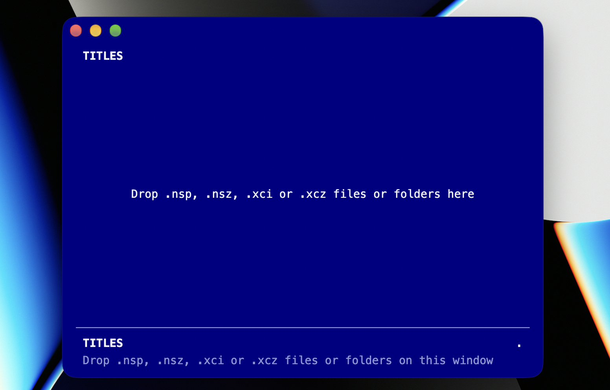

# DBIbackend

 [![release]](https://github.com/GuillaumeMCK/dbibackend-gui/releases/latest)

[release]: https://img.shields.io/github/v/release/GuillaumeMCK/dbibackend-gui?style=flat-square

Install `.nsp`, `.xci`, `.nsz` and `.xcz` files on your Switch over USB with
[DBI](https://github.com/rashevskyv/dbi).



## Get started

1. Download your system's archive from the
   [latest release](https://github.com/GuillaumeMCK/dbibackend-gui/releases/latest).
2. Do the [USB setup](#usb-setup) once.
3. Drop your files or folders on the window.
4. On the Switch, open **DBI › Install title from DBIbackend** and pick the
   titles.

## USB setup

**macOS:**

```bash
xattr -dr com.apple.quarantine dbibackend.app
```

**Windows:** with the DBI menu open and the Switch plugged in, run
[Zadig](https://zadig.akeo.ie/), enable **Options › List All Devices**, select
`057E 3000` and install **WinUSB** (replace libusbK or libusb0 if another
backend installed them).

**Linux:** requires GTK 3.

```bash
echo 'SUBSYSTEM=="usb", ATTRS{idVendor}=="057e", ATTRS{idProduct}=="3000", MODE="0666"' \
  | sudo tee /etc/udev/rules.d/99-dbibackend.rules
sudo udevadm control --reload-rules && sudo udevadm trigger
```

## Reporting bugs

Open a [GitHub issue](https://github.com/GuillaumeMCK/dbibackend-gui/issues).
